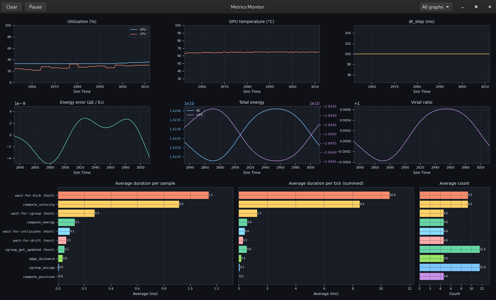

# Orbital Engineer Metrics

A standalone GTK 4 application for live
[Orbital Engineer](https://github.com/efosmark/orbital-engineer) simulation metrics.
It receives JSON over a Unix datagram socket; it does not import or install the
Orbital Engineer engine, OpenCL, or its GUI.



## Development and installation

Requires Linux, Python 3.11+, GTK 4, Cairo, and GObject Introspection. Install your
distribution's GTK 4 / GObject development packages before pip installs PyGObject.
For example, Fedora uses `gtk4-devel gobject-introspection-devel cairo-devel
python3-devel gcc pkgconf-pkg-config`; Debian/Ubuntu uses `libgtk-4-dev
libgirepository-2.0-dev libcairo2-dev python3-dev python3-venv gcc pkg-config`.
Some older distributions do not provide the GI libraries required by current
PyGObject; use a newer distribution or the Flatpak build in that case.

```sh
make dev                     # create .venv and install this package + dev tools
make run                     # or: .venv/bin/orbital-engineer-metrics
make run ARGS='--socket /path/to/metrics.sock'
make watch                   # terminal receiver, instead of the GUI
make test
make wheel                   # Python wheel in dist/
```

An installed package can also run with `python -m ui_metrics`. Run `--help` or
`--version` for options. `--print-socket-path` resolves the selected endpoint
without loading GTK or requiring a display. `requirements.txt` installs this
same package; `pyproject.toml` is the authoritative dependency list.

The Clear button resets histories. Pause freezes the display while continuing
to receive metrics. The Graphs menu toggles graphs individually. Restarting the
producer clears the histories when tick zero or a backward tick/simulation time
is observed. History lengths are **simulation seconds**, configurable in
[`src/ui_metrics/config.py`](src/ui_metrics/config.py).

## Connecting a producer

Native and Flatpak launches default to `/tmp/kernel-metrics.sock`, preserving the original
producer's default. Override this with `--socket PATH` or `OE_METRICS_SOCKET`.
The receiver creates and owns the socket; start it before the producer. Only one
receiver can own an endpoint. The terminal watcher and GUI are alternative
receivers, not two simultaneous subscribers.

Each datagram contains one JSON object:

```json
{
  "name": "tick", "value": 1, "sim_time": 0.1,
  "gpu_utilization": 20, "cpu_utilization": 30, "gpu_temperature": 60,
  "dt_step": 0.1, "num_steps": 2, "energy_error": 0.0001,
  "total_KE": 100000000, "total_GPE": -200000000, "virial_ratio": 1,
  "timeline": [{"name": "step", "duration_ms": 0.25}]
}
```

`value` is the tick ID. `sim_time` and `dt_step` are seconds; timeline durations
are milliseconds. Utilization is percent and temperature is Celsius. Missing or
null metrics are skipped; zero values are retained. Timeline entries may repeat
a name within a tick. Non-tick datagrams and malformed values are ignored.

To try the UI without running a simulation:

```sh
make run
# In another terminal:
python3 examples/send_metrics.py
```

## Flatpak

The manifest uses GNOME 49 (Python 3.13), which supplies GTK, PyGObject, and Cairo.
Other Python dependencies and the build backend are staged as wheels so the
Flatpak build itself runs offline. This does not include the simulation engine.

Install `flatpak`, `flatpak-builder`, `appstreamcli`, and
`desktop-file-validate`, then:

```sh
flatpak remote-add --user --if-not-exists flathub https://flathub.org/repo/flathub.flatpakrepo
flatpak install --user flathub org.gnome.Platform//49 org.gnome.Sdk//49
make dev
make flatpak-check
make flatpak-build            # downloads wheels, builds into flatpak/build
make flatpak-install         # builds and installs for this user
make flatpak-run
make flatpak-bundle          # creates dist/com.qmew.OrbitalEngineer.Metrics.flatpak
```

`vendor-wheels` defaults to x86_64 CPython 3.13. For other architectures or runtime
versions, override `PLAT_TAG` and `PYVER_TAG` with wheel tags matching the target.
`flatpak/python3-deps/wheels/` is generated, not committed. The local `type: dir`
sources are suitable for local packaging; release/Flathub submissions should
replace them with pinned source archives and hashed dependency sources. Choose
and declare the project's code license before publishing; this restructure does
not assign a new license to your code.

### Flatpak socket sharing

The Flatpak manifest explicitly shares the host's `/tmp` directory. Both native
and Flatpak launches default to `/tmp/kernel-metrics.sock`, so a fresh install
works with a native producer without per-user overrides.

The filesystem permission exposes the entire host `/tmp` directory to the app.
No network permission or home-directory access is required. A sandboxed producer
must also have host `/tmp` access to reach the same socket.

`--socket PATH` and `OE_METRICS_SOCKET` still override the default. Both applications
must use the same host-visible path. Existing per-user overrides remain effective.

To test against the Flatpak receiver from the host:

```sh
python3 examples/send_metrics.py
```

## Repository layout

- `src/ui_metrics/`: application, plotting, history model, socket transport, CLI.
- `tests/`: history, protocol/socket lifecycle, and CLI tests; no display required.
- `flatpak/`: manifest, dependency staging, desktop entry, AppStream metadata, icon.
- `examples/`: a synthetic producer for manual testing.

`make clean` removes build outputs; `make distclean` also removes Flatpak builds
and downloaded wheels. Neither removes the virtual environment or source files.
